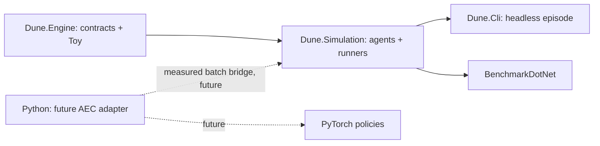

# Architecture

This repository supports infrastructure and configuration for future Dune: Imperium
and Uprising AI. SLICE-001 adds
[ruleset composition](architecture/ruleset-composition.md); SLICE-002 adds
[typed runtime state and deterministic setup](architecture/runtime-state.md).
SLICE-003 adds an [incremental turn engine](architecture/turn-engine.md) with a
[documented supported subset](implemented-mechanics.md), private decisions and replay. **Only the separate toy game is
fully playable.** Authentic setup remains blocked
by incomplete content; the Dune CLI scenario explicitly stops at unsupported data.
Complete gameplay and training remain roadmap work.
The design favors correctness, reproducibility and clear ownership before
throughput optimizations.

The arrows show dependency/data flow toward consumers. C# engine and simulation
have no third-party runtime dependencies. Tests and benchmark libraries remain
outside the engine. No DI container is needed for these constructors and interfaces.

## Engine boundary

The game interface separates configuration/reset, current decision owner,
player-specific observation, legal action enumeration, step, terminal state and
result. Typed observations/actions avoid an unstructured object dictionary.
The complete mutable state belongs to the engine; policy code cannot access it.
Snapshots and replay records are detached immutable/read-only data.

`IGame<TConfig,TObservation,TAction,TResult>` exposes `Reset(int seed, TConfig)`,
`Observe(int playerId)`, `LegalActions(int playerId)`, `Step(TAction)`,
`IsTerminal` and `GetResult()`. `CurrentPlayerId`/`DecisionOwnerId` are nullable at
termination; `Phase` identifies the current phase. The toy additionally exposes a
typed `ToyPhase`. Call `Reset` before state access (`PlayerCount` is constant).
`ToyConfig` has inclusive initial-pile bounds, defaulting to 12–24 and limited to
1–1,000,000; `ToyAction(PlayerId, Amount)` explicitly identifies the acting player.

Reject invalid configuration, invalid player IDs, out-of-turn/illegal actions and
steps after termination before mutating state. Result access before termination
fails explicitly. Legal actions for inactive players are empty, so queries cannot
be used to inspect private opponent decisions. Observation fields contain public
state plus only the requesting player's private data.

Future nested decisions should expose the current decision's owner/type and
stable action IDs rather than letting agents mutate partial state. Chance events
will be sampled by an engine-owned seeded stream, or represented as explicit
chance nodes where search requires enumeration. These are extension directions,
not currently implemented Dune phases or search APIs. Audit chance distribution,
private-state cloning and observation semantics together when adding them.

## Toy environment and replay

The toy game alternates two players taking 1–3 tokens from a pile; the player
taking the final token wins. Seeded initialization and private per-player markers
exercise reproducibility and observation redaction; the markers do not affect
legal actions or scoring. These invented rules have no connection to Dune rules.

Replay reconstructs initialization from version, configuration and seed, then
applies the recorded actions in order. A record may represent a partial or full
episode. Reset must clear history and all private state. The simulation stores
actions, not just agent seeds: reproducing actions is independent of later policy
changes. Full replays are privileged developer/evaluation data, never policy input.
`ToyGame.CreateReplay()` returns a detached `ToyReplay`;
`ToyGame.Replay(record)` reconstructs it. There is no on-disk replay file format yet.

Use seeded `System.Random` under the pinned runtime for now. This established
standard-library choice avoids custom PRNG infrastructure; no benchmark justifies
a specialized generator. Replay determinism is scoped to the engine/rules version
and pinned runtime, not promised across .NET updates. Changing draws/order,
config semantics or RNG algorithm requires an explicit replay-version decision.
Replay rejects foreign engine/rules/runtime versions before applying actions.
No game transition reads clocks, external services or global random state.

## Simulation ownership

Agents select from an observation and legal actions. A random baseline owns its
own seeded RNG, separate from initialization randomness. The runner owns the game
and validates the policy result through the engine. It bounds decisions to catch
nonterminating game/policy defects and propagates cancellation.
Policy constructor seeds are drawn from `System.Random(agentSeed)` in player
order. They do not depend on the environment seed, which remains privileged.

Batch execution creates one game and agent set per episode, processes episodes
with bounded parallelism and returns results in input order. Episode streams must
depend on explicit seeds/identities, never task/thread scheduling. Repeat a batch
at degrees 1 and 4 and compare action histories and results. This is preparation
for self-play, not a claim of measured scalability; trace recording and snapshots
still allocate. Future rollout throughput may need a separately benchmarked
recording/observation-buffer strategy.

`EpisodeRunner<TConfig,TObservation,TAction,TResult>` accepts fresh game and
per-player agent factories. `Run(seed, config, agentSeed: 0, maxSteps: 10_000)`
returns an `EpisodeResult` with seed, policy seed, copied action trace and result;
`RunBatch(seeds, config, degreeOfParallelism: 4)` preserves seed-list order. Each
agent implements `IAgent<TObservation,TAction>.SelectAction(observation,
legalActions, cancellationToken)`. Generic config/action/observation/result values
must be immutable or detached snapshots, and factories must be safe for concurrent
calls. Parallel episode exceptions follow `Parallel.For` aggregation semantics.
For batches, `agentSeed` is a public base policy seed. Episode policy seeds are
drawn in input-index order before parallel execution, independently of environment
seeds. Each result records its actual episode policy seed; replay a policy run
with `Run(result.Seed, config, result.AgentSeed)`. Input order defines episode
identity, and worker scheduling never changes the policy streams.

## Python and RL boundary

`training.agents`, `training.environments` and `training.experiments` are package
boundaries. The current environment utility validates/builds discrete action
masks; there is no second rules implementation or live .NET adapter.

The planned adapter follows [PettingZoo AEC](https://pettingzoo.farama.org/api/aec/):

| RL concept                   | Planned engine mapping                                                                         |
|------------------------------|------------------------------------------------------------------------------------------------|
| `reset(seed=...)`            | Reset episode and independent RNG streams from recorded config                                 |
| `agent_selection`            | Current decision owner; repeated subdecisions may keep the same owner                          |
| `observe(agent)`             | Numeric encoding of public information and that player's private information                   |
| `observation["action_mask"]` | Stable action-ID vocabulary; 1 means legal, 0 means illegal                                    |
| `step(action)`               | Validate against current legal actions, execute one decision                                   |
| rewards                      | Explicit per-agent reward vector; begin with documented terminal outcomes, no implicit shaping |
| terminations                 | Engine terminal outcomes for all players                                                       |
| truncations                  | External rollout limit/cancellation, separate from a game result                               |
| `info`                       | Nonsecret diagnostics/schema IDs; never privileged state                                       |

After termination/truncation use AEC's dead-agent stepping semantics and its
official API/conformance tests. Install the framework with that adapter rather
than build a custom RL framework. The toy winner can map to +1/-1 terminal
rewards in a future adapter; **no reward scheme for actual Dune is selected**.
Observation schema/dtype, variable action IDs and reward conventions must be
versioned before collecting training data. [ADR 0001](adr/0001-csharp-python-interop.md)
evaluates low-overhead batched interoperability and OpenSpiel's possible role.

## Evidence, libraries and performance

| Library/tool                            | Reason                                                                                      |
|-----------------------------------------|---------------------------------------------------------------------------------------------|
| .NET/Python standard libraries          | State, seeded RNG, collections, CLI parsing and small mask utility need no custom framework |
| xUnit v3 + Microsoft test SDK/VS runner | Maintained .NET behavioral test framework and `dotnet test` integration                     |
| BenchmarkDotNet                         | Repeatable warmup/measurement, runtime metadata and memory diagnostics                      |
| pytest                                  | Established independent Python tests                                                        |
| Ruff                                    | One maintained formatter/linter, no overlapping Python format stack                         |
| hatchling                               | Small standard Python package build backend; uv owns package resolution                     |
| mise / uv                               | Toolchain/task orchestration versus package/environment ownership                           |

Only development/test/benchmark packages are installed beyond the language
runtimes. PyTorch (BSD-style), PettingZoo (MIT), OpenSpiel (Apache-2.0) and pythonnet (MIT) are established candidates
for future milestones; evaluate the precise
version's compatibility/license when adding it. No unused ML bridge is installed.

The baseline measures complete toy episodes with allocation diagnostics. Use a
BenchmarkDotNet dry job to verify the harness runs; it is not statistically useful
performance evidence. For design decisions run normal measurements, retain raw
reports locally, and record OS/CPU/runtime/revision/workload. Compare throughput,
latency, GC/allocations, resident memory and scaling as relevant. No claim about
millions of games, GPU utilization or native/managed bridge speed is justified by
this initialization. See [AGENTS.md](../AGENTS.md) for mandatory optimization policy.

Initial baseline measured on 2026-10-24 with `mise run benchmark`: BenchmarkDotNet
0.15.8, SDK 10.0.402, runtime .NET 10.0.13, Ubuntu 26.04.1 x64, Intel i9-13900KF (32 logical / 24 physical cores),
Concurrent Workstation GC. One operation runs a
complete toy episode with fresh game/agents, default config, seed 42, policy seed
0, and trace recording (8 decisions). Fifteen measured iterations used 524,288
operations each; one outlier was removed, leaving 14 for the summary. Results:
**1.460 µs mean**, 0.0046 µs error (99.9% confidence half-width), 0.0041 µs
standard deviation, **5,480 B allocated per operation**.
Process-priority elevation was denied; the benchmark completed at ordinary
priority. These numbers describe this fixed toy workload on this host and do not
predict real Dune or interop throughput. No alternative or optimization was
selected from this measurement. Raw reports/log are retained locally in ignored
`BenchmarkDotNet.Artifacts/policy-seed-baseline/`; rerun to obtain your own results.

Future experiment/evaluation manifests should include engine/rules/observation
versions, Git revision, locks, configs, all seeds, policy checkpoint identity,
metrics and evaluation split. Tracking services and automated policy tournaments
will be chosen when this metadata flow exists; no service/database is added now.

## Base initialization boundary

See [runtime state](architecture/runtime-state.md) for setup lifecycle, physical card
identity/zones, public/private projections, deterministic snapshots and extension
state. [ADR 0003](adr/0003-runtime-initialization.md) documents the standard-library
RNG and synthetic fixture boundary. Initialization ends before Round Start; it
does not implement the Dune `IGame` action loop.
