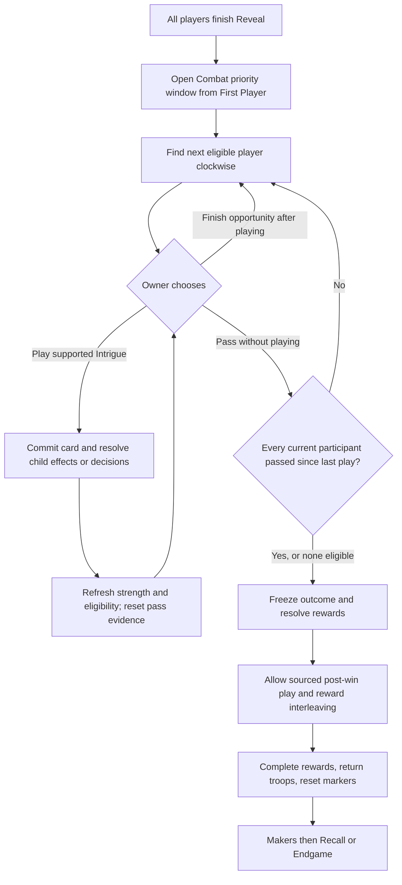

# Complex ability case studies and decision flow

SLICE-003.5, 2026-10-24. Everything under recommended flows is **proposed**, not
implemented. The [audit](ability-decision-audit.md) establishes actual source/test
capabilities; the [design](ability-execution-design.md) assigns prerequisites.

## Authoritative sources and limits

All references below are one-based **PDF** pages, including covers. These are the
supplied editions, not an assertion about current external errata. Text extraction
covered all seven PDFs; I p.13 and M pp.11,14 were also rendered and visually
inspected to resolve columns and card/source distinctions. No card art is copied.

| Key | Exact file under `docs/rules/`                                                                                          | Relevant inspected pages |
|-----|-------------------------------------------------------------------------------------------------------------------------|--------------------------|
| I   | [DUNE_IMPERIUM_Rules_2020_10_26.pdf](../rules/DUNE_IMPERIUM_Rules_2020_10_26.pdf)                                       | 6-13,16                  |
| A   | [DUNE_IMPERIUM_Player_Aid_Icons_and_Board_Spaces.pdf](../rules/DUNE_IMPERIUM_Player_Aid_Icons_and_Board_Spaces.pdf)     | 1-2                      |
| X   | [DUNE_IMPERIUM_RISE_OF_IX_Rulebook_22-2-11.pdf](../rules/DUNE_IMPERIUM_RISE_OF_IX_Rulebook_22-2-11.pdf)                 | 4-7                      |
| M   | [DUNE_IMPERIUM_IMMORTALITY_Rulebook.pdf](../rules/DUNE_IMPERIUM_IMMORTALITY_Rulebook.pdf)                               | 10-11,14                 |
| U   | [DUNE_IMPERIUM_UPRISING_Main_Rulebook_23-10-12.pdf](../rules/DUNE_IMPERIUM_UPRISING_Main_Rulebook_23-10-12.pdf)         | 10-11,14-15,18           |
| S   | [DUNE_IMPERIUM_UPRISING_Rules_Supplements_23-10-12.pdf](../rules/DUNE_IMPERIUM_UPRISING_Rules_Supplements_23-10-12.pdf) | 2 (Board Space Guide)    |
| B   | [DUNE_IMPERIUM_BLOODLINES_Rulebook.pdf](../rules/DUNE_IMPERIUM_BLOODLINES_Rulebook.pdf)                                 | 3-7,12                   |

This is a representative mechanic audit, not a comprehensive card inventory. Exact
missing card boxes and unspecified timing interactions remain evidence gates.

## A. Kwisatz Haderach

### Official evidence

The user's supplied Agent text describes sending an Agent from anywhere to any
board space and drawing one card. That complete face is not established by the
local original rulebook's KH clarification. Treat the text as the case-study
premise, not newly verified catalog data. I p.13 independently verifies taking an
Agent turn with none in supply, moving an Agent already on the board, returning to
the same space, retaining once/game High Council/Swordmaster restrictions, and
being blocked by The Voice. Moving away can leave a Maker space eligible for
bonus spice. I p.9 establishes ordinary costs paid before card/space rewards;
I p.6 allows explicit card exceptions. M p.14 says KH replaces normal sending
rules; Graft, including Ghola copying, still sends only one Agent that turn.

The Voice stops opponents until its creator's next turn and uses an available
Control marker; this is not a generic until-end-of-round lock. (I p.13.)

### Current behavior against the questions

| Question                    | Actual code behavior                                                                                                                                                               | Required extension / evidence boundary                                                                                                                                                                                                                                        |
|-----------------------------|------------------------------------------------------------------------------------------------------------------------------------------------------------------------------------|-------------------------------------------------------------------------------------------------------------------------------------------------------------------------------------------------------------------------------------------------------------------------------|
| Normal placement validation | `TurnEngine.Validate(PlaceAgentAction)` requires unused Agent, visible hand card, matching icon, capacity, affordable board+selected payment, influence and unused once/game space | Keep individual checks, permit only explicit exceptions.                                                                                                                                                                                                                      |
| Select an Agent on board    | No origin selector; `AgentPlacement` only owner/kind, `Place` only adds occupant                                                                                                   | Source must select supply or own existing placement; preserve kind/provenance.                                                                                                                                                                                                |
| Agent turn with none unused | Rejected by `AvailableAgents == 0`                                                                                                                                                 | Evaluate ability-derived placement plan before ordinary availability check. I p.13 permits KH.                                                                                                                                                                                |
| Selectively bypass icons    | Impossible; flat CardRule.Icons and combined access/occupancy check                                                                                                                | Explicit access policy scoped to the selected sending operation; M p.14 supports replacing placement rules. Exact permissions need verified card/ruling data.                                                                                                                 |
| Same-space return           | Ordinary occupied destination fails, no removal/move                                                                                                                               | Validate hypothetical removal of selected own origin before destination check; atomic commit. I p.13 expressly permits return.                                                                                                                                                |
| Occupancy                   | `board.Occupants.Length >= Capacity` blocks everyone; static Capacity 2 test does not implement infiltration                                                                        | Separate own/enemy occupancy and moving-origin exclusion. Supplied any-space text suggests broader access; local KH clarification does not enumerate all cases with additional own/enemy occupants. Keep those cases unresolved, not silently inherited from Ix infiltration. |
| Mandatory cost/influence    | Already checked before rewards; no exception flag                                                                                                                                  | Preserve I p.9 cost/requirements unless independently sourced exception. No assumption that KH is free.                                                                                                                                                                       |
| Once/game                   | `_used` and permanent-upgrade flags block repeat                                                                                                                                   | Retain even if origin==destination or a permission bypasses icons/occupancy. I p.13.                                                                                                                                                                                          |
| Voice                       | No executed bans, no expiration                                                                                                                                                    | Typed destination ban checked independently; KH cannot bypass it. I p.13.                                                                                                                                                                                                     |
| Draw timing                 | DrawEffect exists, but normal Place sends an extra unused Agent first                                                                                                              | Draw belongs after the one exceptional placement, in the permitted card/board effect ordering group (I p.9 + supplied premise), not before mandatory costs. Exact printed-box sequencing remains a card-evidence gate.                                                        |
| Replay                      | Current supported effects replay; no relocation action/state                                                                                                                       | Record origin selection, participant identities, applied policy identity, move and subsequent draw actions/continuations; hash usage and bans.                                                                                                                                |

### Alternatives evaluated

| Strategy                   | Benefit                                                                        | Cost / finding                                                                                                             |
|----------------------------|--------------------------------------------------------------------------------|----------------------------------------------------------------------------------------------------------------------------|
| Dedicated KH action        | Small isolated path                                                            | Duplicates placement costs/occupancy/scheduling if it bypasses shared placement validation. Not the preferred core design. |
| Modified placement context | Uses current action seam; models supply vs relocation and selected permissions | Requires pure placement-plan query before mutation; smallest useful core change.                                           |
| Scoped rule modifier       | Reusable with Voice/infiltration                                               | Persistent registration for this single sending operation is unnecessary; keep permission in operation context.            |
| Reusable relocation effect | Useful later for recall/move operations                                        | Cannot be a normal post-placement effect: that would spend/place another Agent first.                                      |
| Dedicated special handler  | Encodes verified KH exception without card-name switch                         | Handler should produce a placement plan, never perform a separate turn/decision engine.                                    |

**Recommendation:** a small typed special handler produces an Agent placement plan
consumed by the existing placement validator/executor. Represent source Agent,
participant cards, access permissions, costs and one committed sending operation.
Reuse atomic relocation/recall operations underneath when needed. Do not create a
general modifier engine solely for KH, or implement the card in this slice.

### Proposed incremental flow and tests

Select initiating card and, later, optional Graft participant -> choose own source
Agent if multiple meaningful sources -> choose destination and bounded payment ->
validate full operation without mutation -> pay, move one Agent, move participating
hand cards to in-play -> open card/board effects in legal order -> deployment if
eligible -> resume normal scheduler. Deterministic source selection must not be
an artificial policy choice when candidates are strategically identical.

`LegalActions` must include KH when unused count is zero but a legal movable
Agent/destination exists. If selection is staged, initial legal entries must have
at least one legal completion; specify cancellation/commit boundaries. Use stable
public selectors, never allocation-range IDs. A same-space move removes/reinserts
only the chosen placement and pays costs again; it does not refresh once/game use.
Do not decrement unused pool for a board-origin move. Supply-origin does decrement.

Focused future tests: zero-unused relocation; same-space return; cost cannot be
funded by later draw/reward; once/game guard remains; Voice expiry before creator's
next turn; Maker origin becomes vacant; Agent kind preserved; identical legal/Step
policy; failed move preserves RNG/zones/history; one send with KH+Graft and
KH+Ghola; deterministic replay paused at origin/destination/draw. Occupied-space
expectations need explicit verified evidence first. (I pp.9,13; M p.14.)

## B. Combat Intrigue

### Official procedure

Starting at First Player and proceeding clockwise, players with at least one troop
in the Conflict may play any number of Combat Intrigue cards or pass. Passing does
not remove future opportunities; all involved players must pass consecutively.
Strength changes update markers, with zero strength without troops. Cards for
winning a Conflict are played after winning, before the next phase. (I p.12.)

Rewards, ties, zero-strength exclusion and troop return are I p.12. Demand Respect
may use the Conflict's spice reward first, or spice from To the Victor; therefore
post-win play must interleave with permitted reward availability, not always run
before reward effects. (I p.13.) This audit does not infer unprinted Intrigue boxes.

### Current architecture answers

| Requirement                               | Finding                                                                                                                      |
|-------------------------------------------|------------------------------------------------------------------------------------------------------------------------------|
| Shared window                             | Missing: one pending owner exists but no phase/window cursor, pass history or eligible set.                                  |
| Owner changes without new turn            | Already works for ForPlayer/optional frames, with active player retained.                                                    |
| Pass then act again                       | No pass action or scheduler; normal Reveal skipping must not be reused for passes.                                           |
| Effect opens another window               | Nested choices exist; window-as-continuation is missing.                                                                     |
| Active player differs from decision owner | Already tested during PlayerTurns; Combat should have no fictional normal turn.                                              |
| Eligibility changes                       | No Combat eligibility predicate or marker refresh after Intrigue. Reevaluate public participation after an effect completes. |
| Normal vs post-win                        | No IntrigueRule or timing categories. Need separate timing windows over one resolver.                                        |
| Interrupt/resume                          | Acquire-specific continuation works; generic causal completion is missing.                                                   |
| Replay                                    | Can replay current nested choices; new cursor/pass/reward/window state must join trusted snapshot.                           |

### Proposed conceptual flow

Do not rotate priority after each individual card: I p.12 permits multiple cards
within an opportunity. Proposed `PlayIntrigueAction`, `PassPriorityAction`, and
`FinishOpportunityAction` are all GameAction variants; alternatively one explicit
end-opportunity action can distinguish pass vs played using window state. Exact
names are not implemented contracts. A pass is always available to an eligible
player, independent of their private hand contents. A non-playing eligible player
must not be silently forced to pass by the engine.

Window state minimally needs kind/timing, clockwise cursor, priority owner,
whether this opportunity played a card, pass evidence since the last play,
participant revision and suspended continuation. Any card play clears the pass
evidence. Reevaluate eligible players after child resolution; conservatively restart
pass evidence on membership change. The base book gives eligibility and consecutive
pass rules, but does not specify every removal/re-entry edge case or simultaneous
post-win trigger order. Treat restart semantics as a proposed engineering policy
pending sourced card fixtures/rulings, not a new official rule. (I p.12.)

Keep CurrentPlayerId nullable outside Agent/Reveal; DecisionOwnerId identifies
window priority or nested chooser. Once a card starts resolving, no other priority
action is legal until its required child decisions finish. Resume the interrupted
opportunity with the correct owner even when an opponent made the child choice.
Window completion must not call EndAgentTurn/NextPlayer.

### Exact code seams to extend before SLICE-004

- `GameState.GamePhase`: replace the terminal preview boundary with explicit
  Combat/Makers/Recall/Endgame/Completed phases, preserving deliberate versioning.
- `TurnEngine.LegalActions`, `SupportDiagnostics`, `Candidates`, `Validate`:
  dispatch by phase/window before reading `_state.CurrentPlayerId!.Value`.
- `ContinueTurn`: resolve causal children first, then resume a typed parent
  continuation: Agent, Reveal acquisition, Combat opportunity, reward, or phase.
- `GameAction.cs` and `TurnRules.cs`: explicit supported Intrigue timing, play and
  pass/finish actions; owner-only private-card selection and public discard.
- `TurnSnapshot.cs` and trusted game snapshot: include full window, reward/outcome,
  continuation and usage state; retain replay factory/version/initial checks.
- New typed Conflict reward definitions and outcome data; reuse Gain/Recruit/
  Influence operations only when their exact semantics/support are valid.

Essential tests: I p.12's pass/play/pass cycle; two consecutive card plays by one
seat; no-troop seats skipped, no-eligible shortcut; nested opponent decision resumes
priority; strength becomes zero after last troop leaves; post-win card not offered
before a win; ties have no winner; Demand Respect after spice reward/To the Victor (I p.13); replay at every suspended
window; privacy/mask invariance across opponent
hands; invalid timing preserves state/RNG/history. Dynamic eligibility and post-win
ordering tests require an explicitly recorded source interpretation.

## C. Graft and effect composition

### Verified architecture-driving rules

Graft uses exactly two cards, at least one with Graft; an Agent-turn Graft card
cannot be played alone. Either card supplies an Agent icon, both count as sending
the Agent, and both card effects plus board effects resolve in the player's chosen
order. Reveal boxes still work normally. (M p.10.) Both cards are grafted; the
other grafted card means the paired card. Ghola copying and Chairdog's later
return-of-partner example require preserved relationships. (M p.11.)

M p.14 additionally establishes: Ghola copies the whole Agent box including
self-trash; copying does not copy Bene Gesserit card identity; Ghola+Power Play
gives only 2 Influence; Ghola+Weirding Way can give two extra turns; Dispatch an Envoy
adds icons to one selected participant; KH+Graft/Ghola sends only one Agent; Usurp's
row participant is not in play, and its trash can trigger Unload/Replacement Eyes.
These are distinct exceptions, not permission to invent other copied-card behavior.

### Current support and minimum design

The pending list already combines card and board effects with source contexts;
that part is reusable. PlaceAgentAction selects only one hand card. CardRule has
no Graft marker, card-trait predicate, partner, copy definition or action group.
`EffectContext` has one SourceCard; `OwnerId` conflates chooser/recipient. Raw
concatenation loses whether an effect originates on the acting card, the partner,
the board, or a copied definition. A dedicated Graft handler alone is insufficient.

Proposed minimum context: turn/action-group ID; initiating player and card;
participants as physical references with roles/original zones; executing source
card; ability-definition source (separate for copies); paired-card bindings;
decision owner, payer, recipient and typed target; space; timing; continuation.
These are needed roles, not a requirement to add every field in SLICE-004.
Persist only state needed to resume and deterministically recompute the rest.

For ordinary Graft, prepare a two-card selection with a legal completion, derive
permission contributions from each participant, validate one sending operation,
then commit both hand cards and one Agent placement atomically. Enqueue effects
with individual source bindings in the common player-order group. Bind copied
self to the executing copy, retaining the original definition for provenance and
related-card predicates. Do not mutate shared CardRule definitions or the copied
card's printed traits. Add loop/depth rejection for cyclic copy graphs.

Do not flatten icon provenance: X p.7 restricts infiltration to its marked icons;
M p.14 assigns Dispatch icons to a chosen card. Retain action-level send budget 1
for KH interactions without suppressing legitimate extra-turn scheduling from
Ghola+Weirding Way. (M p.14.) Ordinary two-hand-card movement is not a universal
Graft rule: Usurp needs the separately verified public-row participant path.

Future focused tests should pin paired physical identities despite duplicate
definitions, combined icons with per-icon permissions, source-correct self-trash,
if-grafted conditions, copy without printed-trait copying, delayed partner return,
player-chosen effect order, one sending operation, public-row/in-play distinction,
cycle rejection and replay at every participant/target/order decision. (M pp.10-11,14.)

## D. Representative cross-expansion assessment

These mechanics are not implemented at runtime. The table maps sourced rules to
shared extension points; no expansion-specific state is added by this audit.

| Product/mechanic and source                                                                                                                                                                         | Architecture consequence / shared capability                                                                                                                                                                         |
|-----------------------------------------------------------------------------------------------------------------------------------------------------------------------------------------------------|----------------------------------------------------------------------------------------------------------------------------------------------------------------------------------------------------------------------|
| Ix Infiltration: enemy occupants ignored only for marked access icons; own Agent still blocks; Voice still blocks; added Dispatch icons do not inherit infiltration (X p.7)                         | Per-icon permission provenance, independent own/enemy occupancy and destination-ban queries; a static Capacity increase is insufficient.                                                                             |
| Ix Unload: discard or trash invokes Reveal effects; ordinary Reveal also works; Unload grants no discard/trash permission itself. Example discards then trashes same card, triggering twice (X p.7) | Semantic movement reasons, physical source retained after transfer, one trigger per occurrence, child consequences before parent resumes. No blanket per-card deduplication.                                         |
| Ix Tech: acquire effect once, ongoing abilities at varied timings, activated tiles once/round and refreshed next Round Start (X p.4)                                                                | Same typed timing/activation actions and source+round usage ledger; immutable definitions plus per-game ownership/face-up usage. No independent Tech resolver.                                                       |
| Ix dreadnoughts: strength3, swords/Intrigue eligibility with no troops, durability and temporary location control; troop-specific cards do not affect them (X p.6)                                  | Reuse CombatStrength contributions, but add typed unit participation/return/control policies. Runtime troop counters and DeployAction remain troop-only today.                                                       |
| Uprising Spy infiltration and Gather Intelligence: different recall uses; intelligence immediately after placement, before card/space effects; same Spy cannot pay for both (U p.11)                | Precommit payment permissions, distinct after-placement timing hook, explicit target/usage, source-aware context. Reuse placement query and decision infrastructure.                                                 |
| Uprising Agent recall: Imperial Privilege recalls another Agent and draws; distinct from recalling a Spy (S p.2)                                                                                    | Typed Agent target excluding current placement, atomic recall to supply, preserve Agent kind. Do not overload all recall with one untyped token operation.                                                           |
| Uprising sandworms: immediate Conflict deployment, no garrison, Hooks/Shield Wall restrictions; reward doubling with exclusions/cost choices (U pp.10,14)                                           | Typed unit eligibility, summon operation and reward transformation; no simple strength coefficient can implement doubling/cost repetition/control exclusions.                                                        |
| Bloodlines Commanders/Skills: acquire then choose distinct public Skill, persistent owned Skills active while Commander participates; each once/round; later recruit from supply once/turn (B p.4)  | Shared acquisition/choice continuation, typed troop subtype, conditional persistent modifiers, separate acquisition vs recruitment, turn/round usage keys.                                                           |
| Bloodlines Command6+: count Persuasion generated during Reveal, including own card; repeated Combat icons do not multiply old-garrison allowance (B p.5)                                            | Generation total distinct from spendable Persuasion; turn-level deployment entitlement, conditions evaluated at specified Reveal timing. Exact check timing under interleaved spending needs verified card fixtures. |
| Bloodlines optional Tech/full Ix; Uprising integration (B pp.3,6-7; U p.18)                                                                                                                         | Existing explicit composition/replacement modules should select static policies once; unsupported combinations remain gated. Do not inject these states into original-only games.                                    |

Shared extension families are placement permissions, causal continuations, semantic
events/timing, source/target context, usage/lifetime, typed units and reward policies.
Keep module-specific values typed and episode-local only when that module is
implemented; before then, preserve the current execution exclusion.
