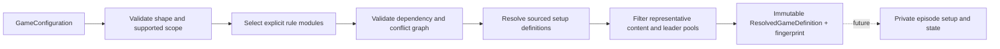

# Ruleset composition

SLICE-001 adds setup-time composition to `Dune.Engine`; it does not implement a
Dune game. The executable Toy game remains a separate invented example. The
first complete-game target is **Dune: Imperium + Rise of Ix + Immortality,
competitive 3–4 players**. Uprising and the other products have explicit identities
and researched compatibility, without any claim that their gameplay is ready.

## Boundary and lifecycle



Configuration, Content and Rulesets namespaces live in the existing Engine
project. A new assembly would add a boundary without an independent consumer or
dependency need. No assembly scanning, service container or per-action discovery
is used. Construct a composer at the application boundary, resolve a configuration
before starting episodes, then reuse the immutable definition across workers.
Each future episode owns its mutable state, card instances and RNG streams.

`RulesetComposer.CreateDefault().Compose(configuration)` returns a
`ResolutionResult`. Invalid input or unsupported scope yields diagnostics with
code/path/message and no partial definition. A recognized format can be rejected
by this implementation even when the official game supports it. Check both the
support status and the definition before use.

## Three different promises

| Status | Meaning |
| --- | --- |
| Recognized | The configuration vocabulary is known, but this slice cannot validate/resolve that combination. |
| Validated | All checks for this slice's representative composition scope passed; the definition contains sourced setup metadata. |
| Playable | Complete setup, inventories, effects, transitions, observations, scoring and replay are implemented and verified. **No Dune configuration has this status.** |

Unknown enum values or schema versions are Unrecognized. Malformed known
configurations return diagnostics. Gameplay support is a separate field and remains NotImplemented for every Dune result. Catalog completeness is
Representative; a successful resolution does not certify a complete official
inventory, executable effect coverage, or a simulation-ready starting deck.
Never pass a composition result into Toy as a substitute for Dune rules.

## Configuration and serialization

`GameConfiguration` distinguishes base game, expansion set, optional module set,
main mode, optional variant set, player format/count, leader selection, content
profile and deterministic environment seed. Values use enums, records and typed
IDs instead of unrelated booleans. Arrays are immutable; set-like inputs reject
duplicates and are sorted only for canonical identity. Seat/draft order remains
ordered. JSON uses System.Text.Json; its [immutable record support](https://learn.microsoft.com/dotnet/standard/serialization/system-text-json/immutability)
and [immutable collection support](https://learn.microsoft.com/dotnet/standard/serialization/system-text-json/supported-types)
avoid a custom serializer or configuration framework. Serialization is setup-time
work; no serialization optimization is claimed.

The profile's identity and revision identify an intentional inventory policy.
An empty `Included` list selects all eligible sample entries; a nonempty list
restricts the sample to those IDs. `Excluded` removes eligible sample entries.
Explicit included/excluded content IDs are checked against known metadata and
availability. They cannot bypass a product/module restriction or silently remove
a required fixed leader. Unknown content IDs fail instead of producing fabricated
cards. Selection from a representative catalog is explicitly incomplete.

## Module contract and conflict handling

The explicit `RulesetComposer(ContentCatalog, IEnumerable<RuleModule>)` constructor
uses the supplied module set as its complete input; it does not discover or inject
missing base modules. This authoring boundary validates graph/merge correctness,
not catalog or executable gameplay completeness. A successful merge must still
provide the five core recipe slots: BoardLayout/main, StartingDeck/player,
Resources/initial, ConflictDeck/recipe and VictoryCondition/threshold. Empty or
sparse module sets fail with incomplete-definition diagnostics.

A `RuleModule` has a stable `ModuleId`, revision, explicit dependencies,
incompatibilities and immutable contributions. A contribution identifies a
`RuleDefinition` by `DefinitionId` and a typed kind/slot key. Kinds distinguish
board layout/spaces, starting deck, resources, conflict deck, card/leader pools,
mechanics, victory conditions and setup. Definition values are descriptive recipe
metadata. They are not an executable effect language.

Adding requires an empty slot. Replacing must name the exact expected prior
definition ID, use the same slot and depend on its producing module. A stale target,
missing dependency, cycle, duplicate ID or competing writer fails. Two sibling
modules cannot decide precedence through registration order. A conditional
interaction needs its own explicit dependency chain and replacement declaration.
Resolved rules retain source/override history for review and hashing. Stable
ordinal ordering is only a deterministic traversal rule, never override priority.

Representative cases include original Ix board replacement, the folded Uprising
Ix overlay, Immortality deck replacement, and the Immortality/Epic interaction.
See the [compatibility matrix](../compatibility-matrix.md) for PDF/page
citations and the exact scope of each rule. Combinations outside the explicit
support scope fail rather than extrapolating from these examples.

## Fingerprint contract

Fingerprint format v2 uses SHA-256 over canonical UTF-8 JSON. Inputs include the
semantic configuration/profile, leader policy parameters, module IDs/revisions,
selected content metadata, final setup definitions and source/override history.
Set-like arrays and mappings use ordinal stable ordering; meaningful player order
is retained. Both the episode seed and independent leader-selection seed are
excluded: different episodes can share one resolved ruleset. Replays/experiment
manifests must record those seeds separately along with the fingerprint and engine,
runtime, configuration and observation versions. A hash is not a replay by itself.

A changed module, definition, availability predicate, quantity, verification status
or source can change identity. A reordered expansion set or module registration
cannot. Do not replace this with `GetHashCode`, culture-dependent formatting or
unordered dictionary traversal. Version the fingerprint format when its contract
changes. No cross-runtime JSON canonicalization claim is made beyond the tested
format under the pinned toolchain.

## Leader selection and agent boundary

The selection configuration models fixed assignments, random assignment,
sequential draft and snake draft. Parameters include independent seed, ordered
seats, optional eligible candidate IDs, fixed seat/leader pairs and reserved
restriction identifiers. Fixed assignments must cover seats uniquely with known,
available leaders. Candidate restrictions must leave enough distinct leaders.
Unsupported restriction policies reject explicitly. Partial sample leader pools
must never be presented as complete official leader sets.

This slice validates the policy description only. It does not sample leaders,
execute an interactive draft, or claim snake draft is an official variant. Fixed,
random and custom draft choices are setup policies; official selection evidence
is indexed separately in the [rules index](../rules-index.md).

A future pregame state machine will expose the acting seat, permitted public pool,
public picks/bans and legal pick/ban actions. A player's observation may additionally
contain only information that policy is allowed to know (for example its own private
offer). It must never contain the full configuration, environment/selection RNG
state or seed, hidden offers, future random ordering, privileged replay or another
player's private selections. Agent-controlled decisions use the same observation
and legal-action boundary as gameplay, with versioned pregame action IDs. An
engine-owned selection stream stays separate from public agent-policy seeds.

## Extending a product

1. Verify local PDF applicability and pages; record unresolved interactions.
2. Add stable product/content IDs and sourced JSON metadata with honest status.
3. Add an explicit module and dependencies. Conditional replacements name their
   exact prior target; do not edit precedence to make a conflict disappear.
4. Expand the supported scope only with tests for positive and exclusion cases.
5. Update the rule ledger, matrix, presets and fingerprint expectations.
6. Keep gameplay readiness NotImplemented until a complete game is verified.

See [ADR 0002](../adr/0002-ruleset-composition.md) and the
[catalog schema](../content/catalog-schema.md). No benchmark was introduced: this
work adds setup metadata and no performance-sensitive execution choice. Measure a
representative simulation workload before optimizing this boundary.

## Representative configuration scope

| Preset ID | Metadata resolved |
| --- | --- |
| `imperium-standard` | Original base, Standard, competitive 3–4. |
| `imperium-ix` | Original with Ix, Standard, competitive 3–4. |
| `imperium-ix-immortality` | First full-game target's composition, Standard, competitive 3–4. |
| `imperium-ix-immortality-epic` | Same products with sourced Epic/Immortality setup override. |
| `uprising-standard` | Uprising base, Standard, competitive 3–4. |
| `uprising-ix` | Uprising with its distinct Ix overlay, competitive 3–4. |
| `uprising-bloodlines` | Uprising with Bloodlines, optional Tech left off, competitive 3–4. |
| `imperium-ix-epic` | Original+Ix Epic, without Immortality. |
| `imperium-ix-immortality-go-to-11` | Standard variant with the four-player exception. |
| `uprising-choam` | Uprising optional CHOAM module. |
| `uprising-bloodlines-tech` | Uprising+Bloodlines with optional Tech. |

Presets default to four players. For three players, set both `Players.Count` and
`Leaders.PlayerOrder` (for example `[0, 1, 2]`); mismatched seat orders reject.
These are all nonplayable. Sources for each row are in the
[combination matrix](../compatibility-matrix.md#combination-matrix).
Additional implemented configuration branches cover original+Ix Epic,
original+Ix+Immortality Standard Go to 11, Uprising CHOAM, and Uprising+Bloodlines
Tech. Use the configuration records or exposed additional presets.

Solo with Rivals, two-player with Rivals, six-player teams, original+Bloodlines,
Uprising+Immortality and larger expansion unions are recognized but outside this
slice's resolver scope. This is an implementation limit, not an official product
incompatibility. Epic+Go to 11 has unresolved target precedence; Bloodlines+Ix
requires separate conditional access/placement work. Unknown enums/modules are
invalid vocabulary. Invalid player counts, missing required products, unavailable
leader IDs and conflicting profile selections report configuration diagnostics.

## API example

```csharp
using Dune.Engine.Configuration;
using Dune.Engine.Rulesets;

var configuration = ConfigurationPresets.All["imperium-ix-immortality"]
    with { RandomSeed = 42 };
var result = RulesetComposer.CreateDefault().Compose(configuration);
if (!result.IsSuccess)
{
    foreach (var error in result.Errors)
        Console.WriteLine($"{error.Code} at {error.Path}: {error.Message}");
}
else
{
    Console.WriteLine(result.Definition!.Fingerprint);
    // Metadata only. Gameplay remains NotImplemented.
}

var json = ConfigurationJson.Serialize(configuration);
var restored = ConfigurationJson.Deserialize(json);
```

JSON syntax/schema errors throw System.Text.Json exceptions. `Compose` validates
semantic shape and supported scope after deserialization. Persist the original
configuration and both seeds with the versioned definition fingerprint.


## SLICE-002 executable setup adapter

Resolved definitions now bind to canonical seed-independent configuration identity
and may carry immutable typed `Setup` data. The ordinary original Imperium Standard
competitive 3/4-player builtin composition receives this adapter for fixed/random
leader policies; other recognized configurations and explicitly supplied module
graphs remain metadata-only. This conservative gate prevents replacements from
silently receiving base behavior. Future expansion adapters must lower their
resolved definitions deliberately, not parse prose or reuse a base recipe implicitly.

A public `RulesetComposer(ContentCatalog)` overload enables an authored complete
catalog with the builtin module registration. The existing explicit-modules
constructor retains its graph-validation semantics. `GameInitializer` separately
validates support and content readiness; gameplay remains NotImplemented.
Fingerprint canonicalization is deliberately v2 to include typed setup and optional
ConflictTier metadata. Full setup and observation contracts are documented in
[runtime state](runtime-state.md); [ADR 0003](../adr/0003-runtime-initialization.md)
records the fixture/RNG decisions.
